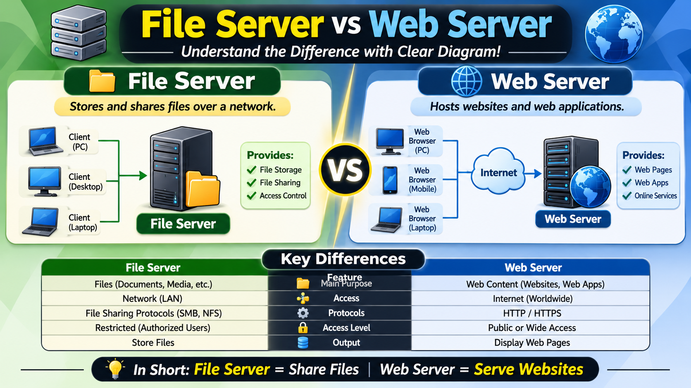
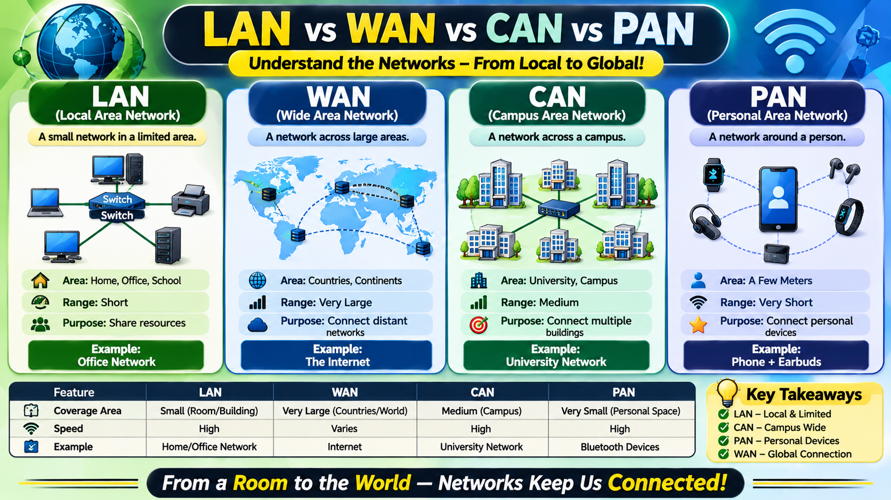
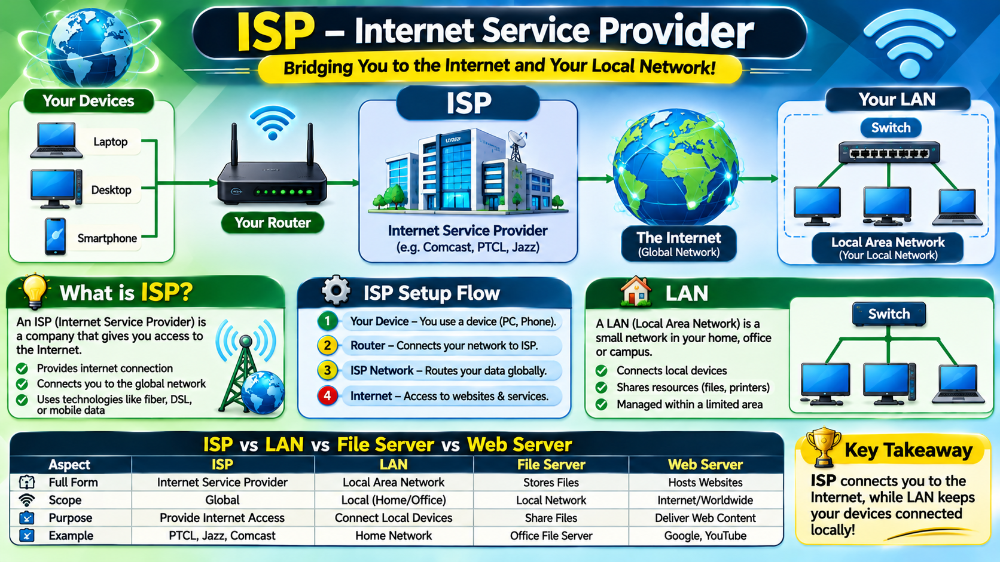
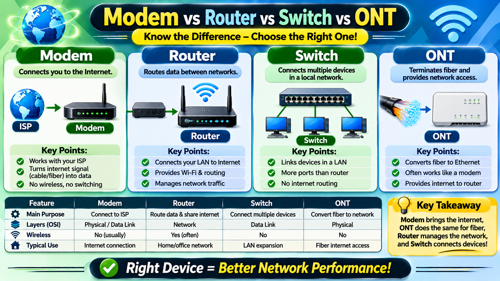
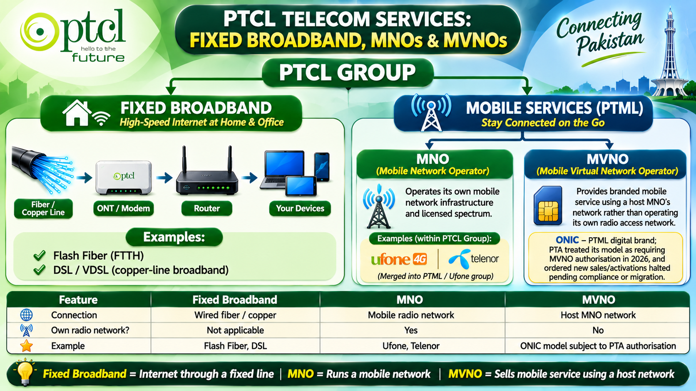

# NETWORKING — Complete Learning Roadmap

## Introduction: Why Networking Is Important in Cybersecurity

Networking is one of the most important foundations of computer science and cybersecurity.

Before understanding tools such as Nmap, Wireshark, Npcap, firewalls, network scanners, and intrusion detection systems, we must understand how computers and other devices communicate.

**To understand cybersecurity properly, you must know networking.**

Why?

Because cybersecurity involves protecting:
- Computers and laptops.
- Servers and websites.
- Routers and switches.
- Home and office networks.
- Data travelling between devices.
- Communication between local networks and the Internet.

For example:
- Nmap helps discover hosts and services on a network.
- Wireshark helps analyze network packets.
- Npcap provides packet-capture functionality on Windows.
- Firewalls control network traffic.
- Network monitoring helps identify unusual communication.

Without networking knowledge, it becomes difficult to understand what these tools are doing and why they are used.

This repository explains networking concepts step by step, starting with servers and network types and moving toward Internet service providers and telecommunications companies.

---

# TOPIC 1 — FILE SERVER VS WEB SERVER



## 1. What Is a Server?

A server is a computer or software system that provides services or resources to other computers called clients.

A client is a device or application that requests something from a server.

### Simple Example

Imagine you are using a laptop and want to open a website.

1. Your browser sends a request.
2. A web server receives that request.
3. The web server processes it.
4. The server sends a response.
5. Your browser displays the website.

In this example:
- Your laptop/browser = Client
- The web server = Server

A server does not have to be a physically special computer. An ordinary computer can perform a server role if it runs the appropriate server software and is configured to provide services.

## 2. What Is a File Server?

A file server is a computer or system that stores files and makes them available to other users or devices over a network.

It allows authorized users to access shared files from their own computers.

### Example

Imagine an office has 20 employees.

Instead of keeping the same company documents on every employee's computer, the company stores them on a central file server.

Employees can access shared documents through the network, depending on their permissions.

### Common Uses

- Sharing documents.
- Storing office files.
- Sharing images and videos.
- Centralized file storage.
- Creating backups.
- Managing access permissions.

### Common File-Sharing Technologies

| Technology | Purpose |
|---|---|
| SMB | Common file and printer sharing protocol, especially on Windows networks |
| NFS | Network file-sharing protocol commonly used in Unix/Linux environments |
| FTP | File Transfer Protocol |
| SFTP | Secure File Transfer Protocol over SSH |

## 3. What Is a Web Server?

A web server is software, and sometimes the computer running it, that responds to web requests from clients such as browsers.

It delivers website content using HTTP or HTTPS.

### Example

When you open a website:

1. You enter its domain name in your browser.
2. Your browser finds the server's IP address through DNS.
3. Your browser sends an HTTP or HTTPS request.
4. The web server responds with website resources.
5. Your browser displays the website.

### Common Uses

- Hosting websites.
- Delivering web pages.
- Providing web applications.
- Delivering images, CSS, JavaScript, and other website resources.
- Handling requests from browsers and applications.

### Common Web Server Software

- Apache HTTP Server
- Nginx
- Microsoft IIS

## 4. File Server vs Web Server

| Feature | File Server | Web Server |
|---|---|---|
| Main purpose | Stores and shares files | Delivers website content |
| Main users | Network users and applications | Browsers and web applications |
| Common protocols | SMB, NFS, FTP, SFTP | HTTP, HTTPS |
| Example | Shared office folder | Online shopping website |
| Main function | File access and sharing | Responding to web requests |

## 5. Is Google a Server?

Google operates many servers, including web servers.

When you search for something:
1. Your browser acts as the client.
2. Google's web service receives your search request.
3. Google processes the request.
4. Google's servers return search results.

However, if you click a PDF hosted on another website, that PDF may be delivered by the server hosting that file—not necessarily by Google.

**Important:** Google Search helps you find content. The website or host providing the content may be a different server.

## 6. Can One Computer Be Both a File Server and a Web Server?

Yes.

A single computer can perform multiple server roles if it runs the required software and has sufficient resources.

For example:
- It can share files through SMB.
- It can host a website through Apache or Nginx.

The terms file server and web server describe different roles, not necessarily different physical machines.

### Key Takeaway

A file server shares files over a network, while a web server responds to web requests and delivers website content.

---

# TOPIC 2 — PAN, LAN, CAN, AND WAN



## 1. What Is a Computer Network?

A computer network is a group of two or more devices connected so they can communicate and share resources.

These devices may include:
- Computers.
- Laptops.
- Mobile phones.
- Printers.
- Servers.
- Routers.
- Smart devices.

Networks can be classified according to their coverage area and purpose.

The four network types covered here are:
- PAN
- LAN
- CAN
- WAN

## 2. PAN — Personal Area Network

PAN stands for **Personal Area Network**.

It is a small network used to connect an individual's personal devices over a short distance.

### Example

Imagine you connect:
- Your mobile phone to wireless earbuds.
- Your laptop to a Bluetooth mouse.
- Your phone to a smartwatch.

These are examples of personal-area connectivity.

### Common Technologies

- Bluetooth.
- USB connections.
- NFC.
- Personal wireless connections.

### Important Point

PAN is generally designed around one person's nearby devices, not an entire home, university, or city.

## 3. LAN — Local Area Network

LAN stands for **Local Area Network**.

It connects devices within a limited geographical area, such as:
- A home.
- An office.
- A computer laboratory.
- A small building.

### Example: Home Network

Imagine your home has:
- One laptop.
- Two mobile phones.
- One smart TV.
- One printer.

These devices can connect to the same home network through Wi-Fi or Ethernet.

They may communicate with one another and share network resources.

### How Are Devices Connected?

A LAN may use:
- Ethernet cables.
- Wi-Fi.
- Switches.
- Routers.

A wireless LAN is commonly called a WLAN.

### Important Point

A LAN can work without an Internet connection.

For example, two computers connected to the same switch can communicate locally even if the ISP's Internet service is unavailable.

**LAN and Internet are not the same thing.**

LAN describes a local network. The Internet is a much larger global network of interconnected networks.

## 4. CAN — Campus Area Network

CAN stands for **Campus Area Network**.

It connects multiple local networks across a campus or a group of nearby buildings.

Common examples include:
- Universities.
- Colleges.
- Large school campuses.
- Corporate campuses.

### Example: University Network

Imagine a university has:
- Administration building.
- Computer science department.
- Library.
- Laboratory.
- Hostel.

Each building may have its own LAN and Wi-Fi access points.

These local networks can be interconnected through the university's network infrastructure, such as fiber-optic links and network switches.

Together, they form a campus-wide network.

### Does a University Need One Big Device?

Not necessarily one single device.

A campus network may use multiple:
- Core switches.
- Distribution switches.
- Routers.
- Fiber-optic links.
- Wireless controllers.
- Access points.

These devices work together to connect the buildings and their networks.

**Important:** CAN here means Campus Area Network. It is not the same as a Controller Area Network used in vehicles and industrial systems.

## 5. WAN — Wide Area Network

WAN stands for **Wide Area Network**.

It connects networks across large geographical areas, such as:
- Different cities.
- Different provinces.
- Different countries.
- Continents.

### Example

Imagine you are in Dera Ismail Khan and make a video call to someone in Islamabad.

Your device connects through your local network and ISP. The communication travels through networks that may span cities and regions before reaching the other person's network.

This communication may involve the Internet, which is the world's largest example of a WAN.

### Common WAN Technologies

- Fiber-optic links.
- Leased lines.
- MPLS.
- Cellular networks.
- Satellite links.
- Internet connections.

## 6. PAN vs LAN vs CAN vs WAN

| Network | Full Form | Coverage | Example |
|---|---|---|---|
| PAN | Personal Area Network | Around one person | Phone and Bluetooth earbuds |
| LAN | Local Area Network | Home, office, building | Home Wi-Fi |
| CAN | Campus Area Network | Campus or multiple nearby buildings | University network |
| WAN | Wide Area Network | Large geographical areas | Networks connected across cities |

## 7. How Can These Networks Work Together?

Consider a university student using a laptop in a university library.

1. The laptop connects to the library's Wi-Fi.
2. The Wi-Fi connects the laptop to the local LAN.
3. The library LAN is connected to the university's campus network.
4. The campus network connects to the ISP.
5. The ISP provides access to the Internet.
6. The Internet carries the request toward the destination server.

This example shows that different network types can work together.

### Key Takeaway

PAN connects personal devices, LAN connects devices in a limited local area, CAN connects networks across a campus, and WAN connects networks over large geographical distances.

---

# TOPIC 3 — ISP AND HOW AN ISP CONNECTS TO A LAN



## 1. What Is an ISP?

ISP stands for **Internet Service Provider**.

An ISP is a company that provides Internet connectivity to customers.

Examples of customers include:
- Homes.
- Offices.
- Universities.
- Schools.
- Businesses.

### Examples of ISPs

In Pakistan, examples of Internet service providers include:
- PTCL.
- Nayatel.
- StormFiber.
- Transworld Home.
- Other licensed local broadband providers.

An ISP connects customers to its network and provides a path toward the wider Internet.

## 2. Does an ISP Create the Internet?

No.

The Internet is a worldwide system of interconnected networks.

An ISP operates part of the infrastructure that allows its customers to access those networks.

ISPs connect to other networks through:
- Fiber-optic links.
- Internet transit providers.
- Internet exchange points.
- Peering connections.
- International connectivity systems.

## 3. What Is the Difference Between ISP and LAN?

| ISP | LAN |
|---|---|
| Provides Internet connectivity | Connects devices locally |
| Operates a service-provider network | Usually belongs to a home, office, or organization |
| Connects customers toward the Internet | Allows local devices to communicate |
| Example: PTCL | Example: Your home Wi-Fi network |

The ISP is not the same as the home LAN.

The ISP provides the connection that allows the home LAN to reach the Internet.

## 4. How Does an ISP Connect to a Home LAN?

Let's understand the connection step by step.

### Example: PTCL Fiber Connection

Imagine you purchase a fiber Internet connection from PTCL.

A simplified connection path looks like this:

```text
Internet
   |
ISP / PTCL Network
   |
Provider's Fiber Infrastructure
   |
Optical Fiber Cable
   |
ONT (at your home)
   |
Router / Wi-Fi
   |
Home LAN
   |
-------------------------
|          |            |
Laptop    Mobile       Smart TV
```

### Step 1: Internet and ISP Network

The ISP has infrastructure that connects its customers to other networks and the wider Internet.

### Step 2: Provider's Network

The ISP uses its own network infrastructure, including fiber-optic cables and provider equipment.

### Step 3: Fiber-Optic Cable

The ISP provides a fiber connection to the customer's premises.

Fiber-optic cables carry information using light signals.

### Step 4: ONT

The fiber cable connects to an ONT installed at the customer's home.

The ONT converts optical signals into electrical network signals that customer equipment can use.

### Step 5: Router

The router connects the home network to the ISP connection.

It directs traffic between the home LAN and the wider network.

A Wi-Fi router can also provide wireless connectivity to phones and laptops.

### Step 6: Home Devices

Devices connect through Wi-Fi or Ethernet.

They become part of the home LAN.

## 5. How Does a Mobile Phone Access the Internet Through Wi-Fi?

Suppose your phone connects to your home Wi-Fi.

The communication path is:

```text
Mobile Phone
     |
Wi-Fi
     |
Router
     |
ONT
     |
ISP Network
     |
Internet
     |
Website Server
```

When you open a website:
1. Your phone sends a request.
2. The router forwards the request toward the ISP.
3. The ISP carries the request toward the destination.
4. The website server responds.
5. The response travels back to your phone.

## 6. Does Every Home Need a Separate Connection to the ISP's Main Network?

No.

An ISP usually has shared distribution infrastructure.

For example, a fiber network can serve many homes through distribution cables, optical splitters, and provider equipment.

Each customer has a connection to the provider's access network, but the entire path back to the ISP's wider network is shared infrastructure.

## 7. What Is the Difference Between Wi-Fi and Internet?

This is a very important concept.

**Wi-Fi** is a wireless networking technology that connects your device to a local network.

**Internet** is the global network of interconnected networks.

You can have Wi-Fi without Internet.

### Example

Suppose your router is switched on but the ISP's fiber connection is disconnected.

Your phone may still connect to Wi-Fi.

However, you may not be able to open websites because the router has no working Internet connection.

Therefore:

- Connected to Wi-Fi does not always mean connected to the Internet.
- Wi-Fi is the local wireless connection.
- The ISP provides the external Internet connection.

### Key Takeaway

An ISP connects a customer's network to the wider Internet. The router connects local devices to the home network, while the ONT or modem provides the appropriate interface to the ISP's access technology.

---

# TOPIC 4 — ONT VS MODEM VS ROUTER VS SWITCH



These four devices have different responsibilities.

They are often confused because modern equipment can combine several of these functions into one physical box.

Let's understand each device separately.

## 1. What Is an ONT?

ONT stands for **Optical Network Terminal**.

An ONT is used in fiber-optic Internet connections.

Its job is to terminate the optical fiber connection and convert optical signals into electrical network signals.

### Simple Explanation

The ISP sends information through fiber using light.

Your home devices do not directly communicate using the light travelling through the fiber.

The ONT converts the optical connection into a form that customer networking equipment can use.

### Where Is the ONT Placed?

In a fiber connection, the ONT is normally installed at the customer's premises.

The fiber-optic cable connects to the ONT.

Its Ethernet output can connect to a router or an integrated networking gateway.

## 2. What Is a Modem?

Modem stands for **Modulator-Demodulator**.

A modem converts signals between the form used by a communication medium and the form needed by the connected networking equipment.

The exact technology depends on the type of modem.

### Common Examples

- DSL modem.
- Cable modem.
- Cellular modem.

### DSL Modem Example

In an older DSL broadband connection:
1. The ISP sends data through telephone-line infrastructure.
2. The DSL modem communicates over the telephone line.
3. It provides an Ethernet connection to a router or computer.

### Is an ONT the Same as a Modem?

They have a similar broad purpose: connecting customer equipment to a provider's access network.

However, they are technically different devices.

- ONT: Used in fiber-optic PON networks.
- DSL modem: Uses digital subscriber line technology over telephone copper wires.
- Cable modem: Uses cable broadband infrastructure.

People sometimes casually call an ONT a fiber modem, but ONT is the more accurate technical term.

## 3. What Is a Router?

A router connects different IP networks and forwards packets between them.

In a home, the router commonly connects:

- The home LAN.
- The ISP's network.

It acts as the gateway between the local network and external networks.

### Main Router Functions

1. Routing: Decides where IP packets should be forwarded.
2. NAT: Often translates private home IP addresses to a public address or provider-assigned address.
3. DHCP: Commonly assigns local IP addresses to devices.
4. Firewall: Many home routers include basic firewall features.
5. Wi-Fi: Wireless routers provide wireless access to the local network.

### Example

Suppose your home has:
- Laptop.
- Mobile.
- Smart TV.

All three devices connect to the router.

The router helps them communicate locally and forwards their Internet traffic toward the ISP.

## 4. What Is a Switch?

A switch connects devices inside a local network.

It forwards Ethernet frames between connected devices using MAC-address information.

### Example

Imagine an office has:
- 10 computers.
- 2 printers.
- 1 server.

An Ethernet switch can connect these devices into the same LAN.

The devices can communicate through the switch, according to the network configuration and security rules.

### Does a Switch Provide Internet?

A basic switch does not independently provide an Internet connection.

It connects devices within a LAN.

If the LAN is connected to a router with working Internet access, the devices connected through the switch can also access the Internet.

## 5. Router vs Switch

| Router | Switch |
|---|---|
| Connects different IP networks | Connects devices within a LAN |
| Forwards IP packets between networks | Forwards Ethernet frames using MAC addresses |
| Acts as a gateway | Expands wired LAN connectivity |
| Commonly connects LAN to WAN | Commonly connects computers and other local devices |

## 6. ONT vs Modem vs Router vs Switch

| Device | Main Purpose | Common Connection |
|---|---|---|
| ONT | Terminates a fiber-optic access connection | Fiber cable to ONT |
| Modem | Connects using technologies such as DSL or cable | Telephone/cable line to modem |
| Router | Connects different IP networks | LAN to WAN |
| Switch | Connects multiple devices in a LAN | Ethernet cables to devices |

## 7. How Are These Devices Connected in a Home?

### Fiber Connection with Separate Devices

```text
ISP Fiber Network
       |
  Fiber Cable
       |
      ONT
       |
    Ethernet
       |
     Router
       |
     Switch
       |
  --------------
  |     |      |
 PC   Printer  Server
```

Mobile phones may connect wirelessly to the router's Wi-Fi.

### Older DSL Connection

```text
ISP Telephone-Line Network
          |
     Telephone Wire
          |
       DSL Modem
          |
        Router
          |
        Switch
          |
       Computers
```

Some DSL modems already include a router and Wi-Fi access point.

### What If All Devices Are Combined?

Modern equipment may combine multiple functions.

For example, a fiber gateway may include:
- ONT functionality.
- Router functionality.
- Wi-Fi access point.
- Ethernet switch ports.

In this situation, you may see only one box in your home.

That does not mean all the functions are identical. It means multiple networking functions have been combined into one device.

## 8. Does Every Home Need a Separate Switch?

No.

A small home with one laptop and one mobile phone may only need a router with Wi-Fi.

A separate switch is useful when:
- More wired Ethernet ports are needed.
- Several computers need wired connections.
- An office has many wired devices.
- A network requires additional wired connectivity.

A switch is not compulsory in every home.

### Key Takeaway

ONT and modems provide access to the ISP's transmission technology. A router connects networks, while a switch connects devices within a LAN.

---

# TOPIC 5 — PTCL, FIXED BROADBAND, MNOs AND MVNOs



This topic explains how telecommunications companies provide Internet and mobile connectivity.

To understand it properly, first learn the difference between fixed broadband and mobile broadband.

## 1. What Is PTCL?

PTCL stands for **Pakistan Telecommunication Company Limited**.

PTCL is a major telecommunications company in Pakistan.

It provides fixed-line telecommunications, broadband, and other communication services.

PTCL also operates in business and wholesale connectivity services.

### Examples of PTCL Services

- Fixed broadband.
- Fiber-optic broadband.
- DSL broadband where available.
- Fixed telephone services.
- Enterprise connectivity.
- Wholesale connectivity services.

## 2. What Is Fixed Broadband?

Fixed broadband is an Internet service delivered to a fixed location, such as:

- A home.
- An office.
- A school.
- A university.
- A business building.

It normally uses physical access infrastructure, such as fiber-optic cable or copper telephone lines.

### Example: PTCL Flash Fiber

PTCL Flash Fiber is an example of a fixed fiber broadband service.

The ISP provides a fiber connection to a customer's premises.

The fiber connects to an ONT, which connects to the customer's router or an integrated gateway.

The home devices then access the Internet through that network.

### Other Examples of Fixed Broadband Providers in Pakistan

- PTCL Flash Fiber.
- Nayatel.
- StormFiber.
- Transworld Home.
- Other regional fiber and fixed broadband providers.

Availability depends on the location and provider coverage.

## 3. Types of Fixed Broadband Access

### A. FTTH — Fiber to the Home

FTTH means Fiber to the Home.

The fiber-optic connection reaches the customer's home.

It is commonly used for high-speed broadband.

### B. DSL — Digital Subscriber Line

DSL provides broadband over existing telephone copper lines.

A DSL modem is used to connect the customer's equipment to the provider's network.

### C. Cable Broadband

Cable broadband uses cable television infrastructure, commonly coaxial cable, to provide Internet access.

### D. Leased Line

A leased line is a dedicated telecommunications connection commonly used by organizations that require predictable connectivity and service characteristics.

It is often used by:
- Banks.
- Large offices.
- Universities.
- Data centers.
- Businesses.

## 4. What Is Mobile Broadband?

Mobile broadband provides Internet connectivity through a cellular mobile network.

It allows users to access the Internet without a fixed physical cable running directly to their homes.

Examples include:
- 4G mobile data.
- 5G mobile data.
- Mobile hotspots.
- Cellular Wi-Fi devices.

### Example

You insert a SIM card into your mobile phone.

Your phone connects wirelessly to a nearby cellular base station.

The mobile network carries your traffic toward the Internet.

The connection path is approximately:

```text
Mobile Phone
     |
Cellular Signal
     |
Mobile Base Station
     |
Mobile Operator Network
     |
Internet
     |
Website Server
```

## 5. Fixed Broadband vs Mobile Broadband

| Fixed Broadband | Mobile Broadband |
|---|---|
| Usually connected to a fixed location | Designed for mobile connectivity |
| Commonly uses fiber or copper access | Uses cellular radio networks |
| Example: PTCL Flash Fiber | Example: Ufone or Jazz mobile data |
| Commonly uses an ONT or DSL modem | Uses a mobile phone, cellular modem, or hotspot |
| Coverage depends on fixed infrastructure | Coverage depends on cellular network coverage |

**Important:** Both fixed and mobile broadband provide Internet access, but they use different access technologies.

---

## 6. What Is an MNO?

MNO stands for **Mobile Network Operator**.

An MNO is a company that operates a cellular mobile network and provides mobile communication services to customers.

An MNO generally has its own licensed mobile spectrum and operates or controls major parts of its mobile network infrastructure.

### What Does Spectrum Mean?

Spectrum refers to the range of radio frequencies used for wireless communication.

Mobile operators use licensed frequency spectrum to communicate with mobile devices through cellular base stations.

### What Infrastructure Does an MNO Use?

An MNO's network can include:

- Mobile towers and base stations.
- Radio access network equipment.
- Core network systems.
- Transmission links.
- Subscriber management systems.
- SIM and authentication systems.
- Connections to other networks and the Internet.

### What Services Does an MNO Provide?

- Voice calls.
- SMS.
- Mobile Internet.
- 4G and 5G services where available.
- Mobile roaming.
- SIM and eSIM services.

## 7. Examples of Mobile Network Operators in Pakistan

Examples of major mobile operator brands and network operations include:

### A. Jazz

Jazz is a major mobile telecommunications brand in Pakistan.

It provides services such as:
- Voice calls.
- SMS.
- Mobile data.
- 4G connectivity.
- Other mobile communication services.

### B. Zong

Zong is the mobile brand of China Mobile Pakistan.

It provides:
- Voice services.
- SMS.
- Mobile broadband.
- 4G connectivity.
- Other cellular services.

### C. Ufone

Ufone is the mobile brand operated by Pak Telecom Mobile Limited (PTML), a subsidiary of PTCL.

It provides:
- Voice calls.
- SMS.
- Mobile Internet.
- 4G services.
- Other cellular communication services.

### D. Telenor Pakistan — Important Corporate Change

Telenor Pakistan was previously a separate mobile operator.

However, it was formally amalgamated into PTML (Ufone) on July 1, 2026.

Therefore, when discussing Pakistan's current mobile industry, do not describe Telenor Pakistan as an independent company separate from PTML after that merger.

The Telenor brand and customer migration arrangements may be distinct from the legal identity of the merged company.

### E. SCO Mobile

SCO stands for Special Communications Organization.

SCO provides telecommunications services in areas including Azad Jammu and Kashmir and Gilgit-Baltistan.

Its role and coverage are different from the nationwide commercial operators.

### Important Note About MNO Examples

Company ownership, brands, licenses, and mergers can change over time.

Always distinguish:
- The brand customers see.
- The legal company operating the network.
- The company that owns the business.
- The regulator-issued license.

---

## 8. What Is an MVNO?

MVNO stands for **Mobile Virtual Network Operator**.

An MVNO provides mobile services to customers without owning its own licensed mobile frequency spectrum.

Instead, it makes a commercial agreement with an existing licensed MNO and uses that operator's network capacity and facilities.

### Simple Explanation

Imagine there is an MNO called Network A.

Network A owns or operates the mobile network infrastructure and has licensed spectrum.

Now another company wants to provide mobile services under its own brand.

Instead of building a complete cellular network and obtaining its own spectrum, it signs an agreement with Network A.

The new company can then offer mobile services to customers using Network A's network, subject to its license and agreement.

That company can be an MVNO.

### How Does an MVNO Work?

```text
             MNO
      Owns/operates network
       and licensed spectrum
              |
       Network Agreement
              |
             MVNO
      Its own mobile brand
       and customer offers
              |
           Customers
```

The actual technical and commercial arrangement can vary between MVNO models.

## 9. What Does an MVNO Own and What Does It Use?

An MVNO may operate its own:
- Brand name.
- Marketing.
- Customer service.
- Billing systems.
- Customer applications.
- Customized service packages.

It uses the host MNO's network and spectrum according to its commercial agreement and regulatory permissions.

The MVNO does not receive its own spectrum assignment simply because it has an MVNO license.

## 10. MNO vs MVNO

| Feature | MNO | MVNO |
|---|---|---|
| Full form | Mobile Network Operator | Mobile Virtual Network Operator |
| Own licensed mobile spectrum | Yes | No |
| Operates major cellular network infrastructure | Yes | Uses host MNO's infrastructure |
| Provides mobile services | Yes | Yes |
| Can have its own brand | Yes | Yes |
| Needs a relationship with an MNO to provide service | Not in the same way | Yes |
| Example | Jazz or Zong | A separately licensed virtual operator using an MNO's network |

### Simple Example

Imagine:

- Network A owns the mobile network.
- Company B makes an agreement with Network A.
- Company B sells mobile packages under its own brand.
- Customers use Company B's service through Network A's mobile network.

Network A is the MNO.

Company B is the MVNO, provided it meets the relevant licensing and regulatory requirements.

---

## 11. MVNOs in Pakistan

Pakistan has introduced a policy framework for Mobile Virtual Network Operators.

Under this framework, an MVNO can provide mobile communication services under its own brand by entering into a commercial agreement with a licensed MNO.

The framework does not give an MVNO its own spectrum assignment.

### What Does the Pakistani MVNO Framework Allow?

Subject to its license and agreements, an MVNO may:

- Use its own brand.
- Develop its own marketing strategy.
- Offer customized services.
- Set up customer-care systems.
- Operate billing systems.
- Use the host MNO's assigned spectrum and numbering resources under the permitted arrangements.

### Does Pakistan's MVNO Framework Mean Every Separate Mobile Brand Is an MVNO?

No.

A separate brand or mobile application does not automatically make a company an MVNO.

The company must meet the applicable PTA licensing and regulatory requirements.

For example, ONIC has been marketed as a digital mobile brand associated with PTML/Ufone. It should not automatically be described as an independently licensed MVNO. Its regulatory status and permissions must be checked against current PTA decisions.

### Are There International MVNO Examples?

Yes. Examples of well-known MVNO business models in other markets include:

- Mint Mobile in the United States.
- Tesco Mobile in the United Kingdom.
- Google Fi in the United States.

These are examples of the MVNO business model internationally, not examples of Pakistani licensed MVNOs.

### Why Do MVNOs Exist?

MVNOs can:
- Increase competition.
- Offer specialized packages.
- Target specific customer groups.
- Introduce different pricing models.
- Provide digital-first customer services.
- Give customers more choices.

### Important Difference

An MNO builds or operates the mobile network and uses its licensed spectrum.

An MVNO provides mobile services through an agreement with an existing MNO rather than holding its own mobile spectrum assignment.

---

## 12. PTCL Group and Its Different Services

PTCL Group is associated with several telecommunications and related business activities.

It is important to understand that PTCL and Ufone do not perform exactly the same role.

### PTCL

PTCL provides fixed telecommunications and broadband services, including:
- Fiber broadband.
- Fixed-line services.
- Business connectivity.
- Wholesale and carrier services.

### PTML / Ufone

PTML is the legal company operating under the Ufone brand.

It provides cellular mobile communication services.

PTML is a wholly owned subsidiary of PTCL.

### Telenor Pakistan

Telenor Pakistan was acquired by PTCL and formally amalgamated into PTML on July 1, 2026.

This is important when learning about the current structure of Pakistan's telecommunications industry.

### U Microfinance Bank

U Microfinance Bank is another company associated with the PTCL Group.

It provides microfinance and banking services. It is not an ISP or MNO.

### Simple Group Understanding

```text
                PTCL Group
                    |
        ---------------------------
        |            |            |
       PTCL         PTML        U Bank
        |            |
  Fixed Broadband  Ufone
  Fixed Services   Mobile Services
                     |
              Telenor Pakistan
               (merged into PTML)
```

This is a simplified learning diagram, not a complete legal ownership chart.

---

## 13. Fixed Broadband vs MNO vs MVNO — Final Comparison

| Term | Meaning | Example |
|---|---|---|
| Fixed Broadband Provider | Provides Internet to a fixed location | PTCL Flash Fiber |
| MNO | Operates a cellular mobile network | Jazz, Zong, Ufone/PTML |
| MVNO | Provides mobile services using an MNO's network without its own spectrum assignment | International examples include Mint Mobile |

Remember:

- Fixed broadband is a type of Internet access.
- MNO is a type of mobile network operator.
- MVNO is a mobile service-provider business model that relies on an MNO's network.

These terms describe different things, so they should not be treated as interchangeable.

### Key Takeaway

PTCL provides fixed broadband services such as Flash Fiber, while PTML operates Ufone mobile services. MNOs operate cellular networks, whereas MVNOs provide mobile services through agreements with existing MNOs.

---

# FINAL NETWORKING REVISION

## 1. All Five Topics at a Glance

| Topic | Main Concept | What You Learned |
|---|---|---|
| 1 | File Server vs Web Server | How servers provide resources and website content |
| 2 | PAN, LAN, CAN, WAN | How networks are classified by coverage |
| 3 | ISP and LAN | How an ISP connects a local network to the Internet |
| 4 | ONT, Modem, Router, Switch | The different responsibilities of networking devices |
| 5 | PTCL, Fixed Broadband, MNO, MVNO | How telecommunications companies provide connectivity |

## 2. Important Networking Terms

| Term | Full Form / Meaning |
|---|---|
| ISP | Internet Service Provider |
| LAN | Local Area Network |
| WAN | Wide Area Network |
| PAN | Personal Area Network |
| CAN | Campus Area Network |
| WLAN | Wireless Local Area Network |
| ONT | Optical Network Terminal |
| FTTH | Fiber to the Home |
| DSL | Digital Subscriber Line |
| MNO | Mobile Network Operator |
| MVNO | Mobile Virtual Network Operator |
| PTCL | Pakistan Telecommunication Company Limited |
| PTML | Pak Telecom Mobile Limited |
| DHCP | Dynamic Host Configuration Protocol |
| DNS | Domain Name System |
| IP | Internet Protocol |
| MAC | Media Access Control |

## 3. The Complete Home Internet Connection

Understand this complete example:

```text
                 INTERNET
                    |
              ISP NETWORK
                    |
            PROVIDER FIBER
                    |
               FIBER CABLE
                    |
                   ONT
                    |
                 ROUTER
                    |
              HOME NETWORK
                    |
          ---------------------
          |         |         |
        Laptop    Mobile     Smart TV
```

The ISP supplies the connection.

The ONT terminates the fiber connection.

The router connects the home network to the ISP network and provides local connectivity.

The devices connect to the home network through Wi-Fi or Ethernet.

A separate switch can be added when more wired connections are required.

## 4. Why Networking Is Essential for Cybersecurity

Networking is not just about connecting computers. It is also about understanding how data travels, how devices communicate, and how networks can be protected.

These concepts help explain:

### Nmap
Nmap discovers hosts, scans ports, and identifies services on authorized networks.

### Wireshark
Wireshark captures and analyzes network traffic.

### Npcap
Npcap provides packet-capture functionality on Windows for compatible applications.

### Firewalls
Firewalls control network traffic according to security rules.

### Network Reconnaissance
Reconnaissance helps identify systems and services in an authorized assessment.

### Cyber Safety Box
A network-monitoring project can compare router-reported connected devices with an administrator's registered-device list and use packet-capture tools to study traffic visible to its monitoring computer.

**Networking knowledge gives you the foundation to understand all these cybersecurity tools.**

---

# OFFICIAL AND LEARNING RESOURCES

- PTCL Official Website: https://ptcl.com.pk/
- Pakistan Telecommunication Authority: https://www.pta.gov.pk/
- Nayatel: https://nayatel.com/
- StormFiber: https://stormfiber.com/
- Transworld Home: https://transworld-home.com/
- Cisco Networking Learning: https://www.cisco.com/
- Cloudflare Learning Center: https://www.cloudflare.com/learning/

For Pakistan's MVNO policy, refer to the Ministry of IT and PTA publications. For current company structures, mergers, and licensing status, check official company and regulatory announcements.

---

# FINAL MESSAGE

Networking is the foundation of communication between computers, servers, mobile devices, and other systems.

Understanding networking helps us understand how the Internet works, how devices connect, how information travels, and how cybersecurity tools monitor and protect communication.

**Before becoming skilled in cybersecurity, build a strong foundation in networking.**

Learn the concepts, understand the connections, and then move toward practical work.

**Learn Networking → Understand Communication → Build Cybersecurity Skills.**
